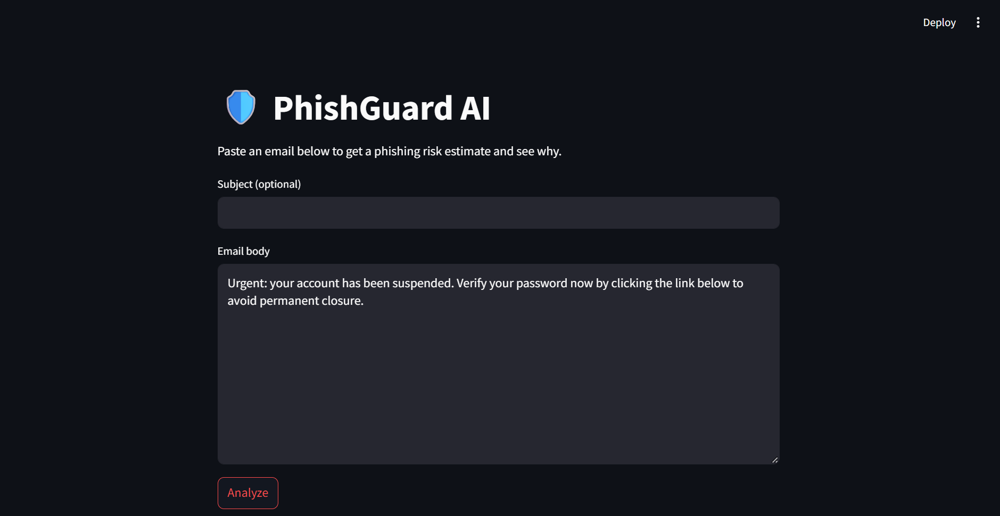
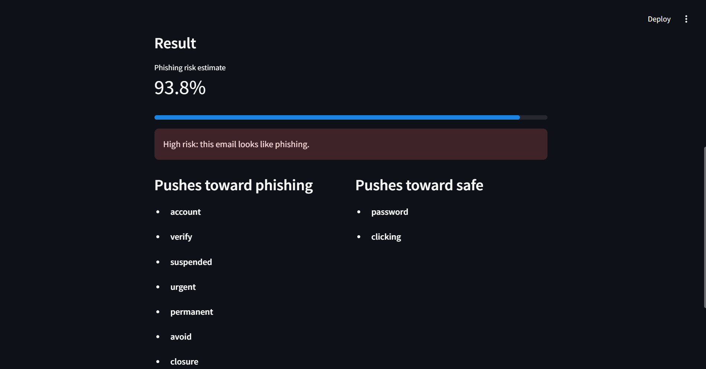
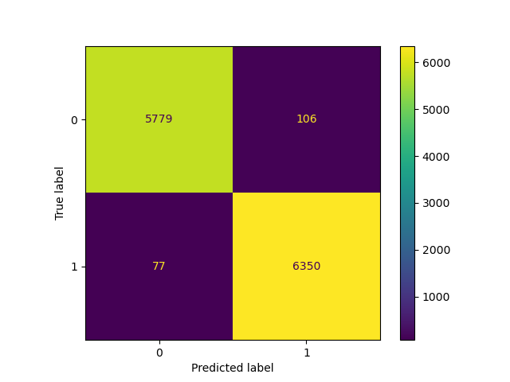

# PhishGuard AI

An explainable phishing email detector built with NLP and machine learning. Paste an email into the web app and get a phishing risk estimate plus the words that influenced the decision.

## App Screenshots

## Features
- TF-IDF text features with unigrams and bigrams
- Compared Naive Bayes, Logistic Regression and Linear SVM
- Risk percentage with word-level explanations
- Streamlit web app

## Dataset
Public Kaggle "Phishing Email Detection" dataset (not included in this repo). Download it from Kaggle, rename the CSV to `emails.csv`, and place it in a `data/` folder.

## Model comparison (validation set)

| Model | N-gram | Precision | Recall | F1 |
|---|---|---|---|---|
| Naive Bayes | (1,1) | 0.9833 | 0.9693 | 0.9763 |
| Logistic Regression | (1,1) | 0.9833 | 0.9880 | 0.9856 |
| Linear SVM | (1,1) | 0.9905 | 0.9918 | 0.9911 |
| Naive Bayes | (1,2) | 0.9904 | 0.9589 | 0.9744 |
| Logistic Regression | (1,2) | 0.9856 | 0.9879 | 0.9867 |
| Linear SVM | (1,2) | 0.9908 | 0.9932 | 0.9920 |

Logistic Regression (1,2) was used in the app because it gives probabilities and easy word-level explanations.

Test set results (Logistic Regression, unigrams + bigrams, 12,312 held-out emails):

| Class | Precision | Recall | F1 |
|---|---|---|---|
| Safe (0) | 0.9869 | 0.9820 | 0.9844 |
| Phishing (1) | 0.9836 | 0.9880 | 0.9858 |

Accuracy: 0.9851 | ROC-AUC: 0.9987

These scores are measured on a random split of a single dataset. Performance on emails from other sources may be lower.

## How to run
1. Install libraries: `pip install -r requirements.txt`
2. Place the dataset at `data/emails.csv`
3. Run all cells in `phishguard.ipynb` to train the model (it saves `models/phishguard.pkl` and creates `app.py`)
4. Start the app: `streamlit run app.py`

## Limitations
- The risk score is an estimate, not proof that an email is malicious.
- The dataset contains older emails and repeated templates, so real-world performance may be lower than these scores.
- Dataset bias: words like "password" and "clicking" pushed predictions toward safe, likely because of the legitimate emails in the training data.
- Not tested on external datasets yet.
